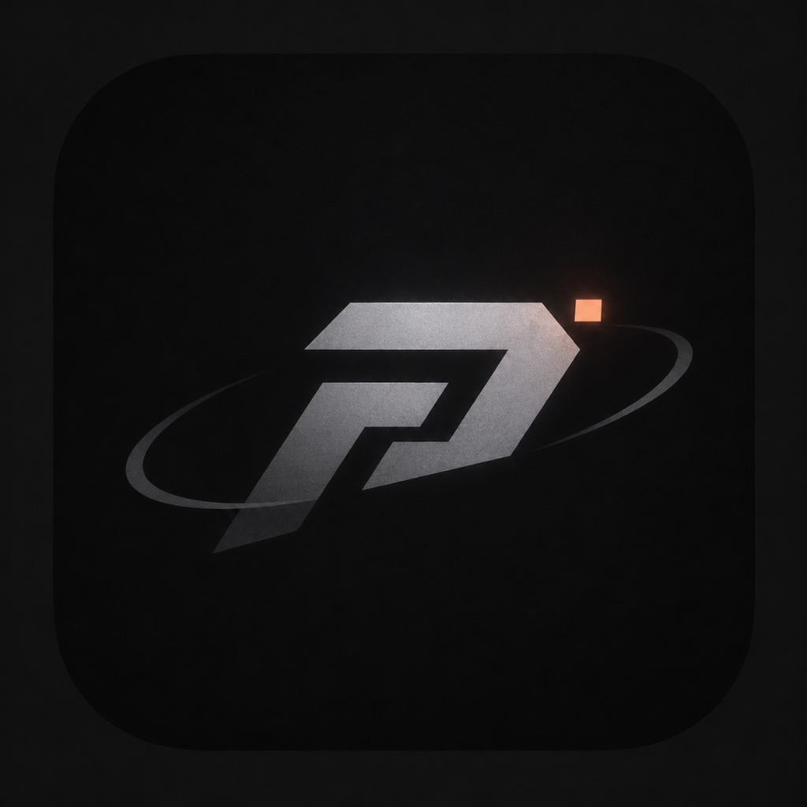

<div align="center">



```
    ____  ____  _________  __  ___
   / __ \/ __ \/  _/ ___/ /  |/  /
  / /_/ / /_/ // / \__ \ / /|_/ / 
 / ____/ _, _// / ___/ // /  / /  
/_/   /_/ |_/___//____//_/  /_/   
```

# PRISM

**Discord Bot Management & Control Suite**

*A powerful terminal studio to design embeds, manage a fleet of Discord bots & webhooks, run autonomous bot modules (AutoMod, AI Assistant, Welcomer, Tickets with Modals & HTML Transcripts), manage giveaways, and assign roles via interactive buttons and select menus.*

<br/>

**English** · [Русский](README.ru.md)

<br/>

[](https://www.python.org/)
[](LICENSE)
[](#)
[](https://github.com/an1zy)

<br/>

[](https://github.com/an1zy/prism-discord/releases)

*Portable single-file build. Download and run, no Python installation needed.*

</div>

---

## ✨ Features & Highlights

### 🤖 Bot Modules & Autonomous Systems
- **Ticket Support Engine:** Deploy interactive ticket creation panels into any channel with 1 click. Features native **Discord Modals** (popup forms with topic and detailed description fields), auto-creates private thread channels, pings staff roles, and includes a **Close Ticket** button.
- **HTML Ticket Transcripts:** Upon closing a ticket, PRISM parses message history and exports a styled Discord-dark-themed `.html` transcript file, posts it into the ticket thread, and forwards a copy to the moderation log channel.
- **AutoMod & Moderation Suite:** Real-time protection against server invite links, flood/spam bursts, excessive caps, and custom banned words. Includes terminal and in-chat moderation commands (`!ban`, `!kick`, `!mute`, `!unmute`, `!clear`, `!warn`, `!slowmode`).
- **AI Chat Assistant:** Integrate conversational AI (Google Gemini, OpenAI, Groq, OpenRouter) into your server with per-user conversation memory and configurable mention/channel triggers.
- **Welcomer & Auto-Roles:** Welcome new members with custom embed cards showing their avatar and count, and automatically grant starting roles upon joining.

### 🎮 Interactive UI Components
- **Reaction Roles & Select Menus:** Attach Discord Select Menus (up to 25 items) and Buttons to embeds. Grant/remove roles, send ephemeral replies, or route to ticket categories.
- **Automated Timed Giveaways:** Launch giveaways with custom countdown timers. PRISM tracks participants with duplicate prevention, draws random winners on expiry or via manual roll (`R`), and posts winner announcements.
- **Discord Modals:** Native pop-up text entry forms that eliminate the need for multi-step bot chat questionnaires.

### 🖥️ Operator Experience & Background Service
- **Windows System Tray Support:** Minimize the bot directly into the Windows system tray (near the clock) using command `t` or flag `--tray`. Runs 24/7 silently in the background without cluttering your taskbar.
- **Live Operator Command Center:** Interactive terminal CLI with real-time logging, participant lists, winner rolls, and instant moderation actions.
- **Persistent Components (`components.json`):** Buttons and select menus are saved to disk so all existing Discord messages remain fully interactive even across server or bot restarts.
- **Bilingual Interface (RU / EN):** Auto-detects system locale with manual switching in settings.
- **5 UI Themes:** Peach Minimalist, Cyber Neon, Rose Quartz, Emerald Matrix, and Monochrome.

---

## 🚀 Installation & Quick Start

### Option 1: Standalone Binary (Recommended for Windows)

1. Download `prism_windows_x64.exe` from [Releases](https://github.com/an1zy/prism-discord/releases).
2. Double-click the executable to launch PRISM.

### Option 2: Run from Source with Python

```bash
# Clone the repository
git clone https://github.com/an1zy/prism-discord.git
cd prism-discord

# Install requirements
pip install -r requirements.txt

# Run PRISM Studio
python prism.py
```

---

## ⚙️ CLI Flags & Background Service

PRISM supports automated headless runs, background listeners, and tray daemons:

```bash
# Run 24/7 listener in the console
python prism.py --listen --bot "MyBot"

# Run 24/7 listener minimized directly into Windows System Tray
python prism.py --listen --bot "MyBot" --tray

# Preview an embed template in the terminal
python prism.py --preview rules

# List all available embed templates
python prism.py --list

# Send a preset via webhook headlessly
python prism.py --send announcement --webhook "https://discord.com/api/webhooks/..."
```

---

## 🛠️ Building Standalone Binary

To package PRISM into a standalone `.exe`:

```bash
python build_exe.py
```
The compiled binary will be placed in `dist/prism_windows_x64.exe`.

---

## 📄 License & Credits

Created by **[an1zy](https://github.com/an1zy)**.  
Released under the [MIT License](LICENSE).
