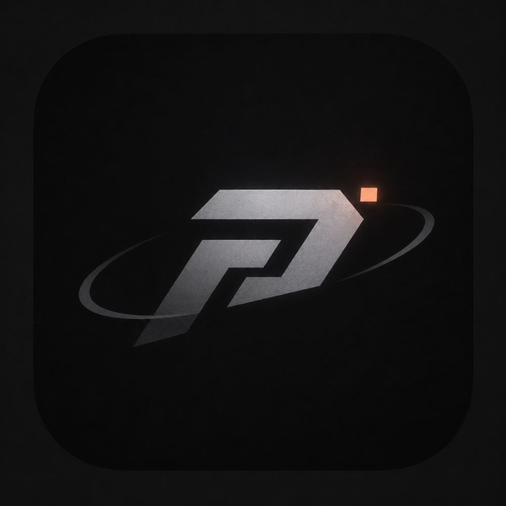

<div align="center">



```
    ____  ____  _________  __  ___
   / __ \/ __ \/  _/ ___/ /  |/  /
  / /_/ / /_/ // / \__ \ / /|_/ / 
 / ____/ _, _// / ___/ // /  / /  
/_/   /_/ |_/___//____//_/  /_/   
```

# PRISM

**Командный центр и управление ботами Discord**

*Мощная терминальная студия для создания интерактивных эмбедов, управления флотом ботов и вебхуков Discord, автономных модулей (AutoMod, AI Ассистент, Welcomer, Тикеты с модальными окнами и HTML-транскриптами), автоматических розыгрышей и выдачи ролей по кнопкам и выпадающим спискам.*

<br/>

[English](README.md) · **Русский**

<br/>

[](https://www.python.org/)
[](LICENSE)
[](#)
[](https://github.com/an1zy)

<br/>

[](https://github.com/an1zy/prism-discord/releases)

*Автономный портативный `.exe` бинарник. Скачай и запусти без установки Python.*

</div>

---

## ✨ Возможности и модули

### 🤖 Модули ботов и автономные системы
- **Тикет-система (Support Tickets):** Развёртывание панели тикетов в любой канал сервера в 1 клик. Поддержка **модальных всплывающих окон Discord** (формы ввода темы и описания), автоматическое создание приватных веток, пинг роли поддержки и кнопка закрытия тикета.
- **HTML-стенограммы тикетов (Transcripts):** При нажатии на кнопку закрытия тикета бот считывает историю сообщений, генерирует красивый `.html` файл с тёмной темой Discord, отправляет его в чат тикета и дублирует в канал логов администрации.
- **AutoMod и модерация:** Защита от спама/флуда, ссылок-приглашений, капса и банвордов. Поддержка консольных команд оператора и команд прямо в чате (`!ban`, `!kick`, `!mute`, `!unmute`, `!clear`, `!warn`, `!slowmode`).
- **AI Чат-Ассистент:** Интеграция нейросетей (Google Gemini, OpenAI, Groq, OpenRouter) с памятью контекста диалога по пользователям.
- **Welcomer и Авто-роли:** Автоматическая выдача роли новичкам при входе на сервер и отправка карточки приветствия с аватаром.

### 🎮 Интерактивные компоненты Discord
- **Выпадающие списки (Select Menus) и кнопки:** Добавление списков выбора ролей (до 25 пунктов) или кнопок верификации к любому сообщению.
- **Автоматические розыгрыши (Giveaways):** Запуск розыгрышей с обратным отсчётом. Бот ведёт учёт участников без дублей, сам выбирает победителя по таймеру (или досрочно по клавише `R`) и публикует объявление в канал.
- **Модальные окна (Discord Modals):** Нативные всплывающие окна Discord для заполнения анкет и обращений без лишних вопросов в чате.

### 🖥️ Комфорт и фоновая работа
- **Системный трей Windows (Tray Icon):** Возможность свернуть бота к часам Windows командой `t` или флагом `--tray`. Бот работает 24/7 в фоне, не занимая место на экране и панели задач.
- **Командный центр оператора:** Удобный терминал с логами кликов в реальном времени, списком участников розыгрышей и модерацией.
- **Персистентность компонентов (`components.json`):** Все кнопки и списки сохраняются на диск — бот продолжает отвечать на них даже после перезапуска программы.
- **Двуязычный интерфейс (RU / EN):** Автоопределение языка системы или ручное переключение.
- **5 цветовых тем оформления:** Peach Minimalist, Cyber Neon, Rose Quartz, Emerald Matrix и Monochrome.

---

## 🚀 Установка и быстрый старт

### Вариант 1: Автономный EXE (Рекомендуется для Windows)

1. Скачайте `prism_windows_x64.exe` со страницы [Releases](https://github.com/an1zy/prism-discord/releases).
2. Запустите двойным кликом.

### Вариант 2: Запуск из исходного кода Python

```bash
# Клонирование репозитория
git clone https://github.com/an1zy/prism-discord.git
cd prism-discord

# Установка зависимостей
pip install -r requirements.txt

# Запуск PRISM Studio
python prism.py
```

---

## ⚙️ Команды CLI и фоновый режим

PRISM поддерживает быстрый запуск через аргументы командной строки:

```bash
# Запустить слушатель бота 24/7 в консоли
python prism.py --listen --bot "MyBot"

# Запустить слушатель сразу свёрнутым в трей Windows
python prism.py --listen --bot "MyBot" --tray

# Предпросмотр шаблона в консоли
python prism.py --preview rules

# Список доступных шаблонов
python prism.py --list

# Отправка шаблона через вебхук в фоне
python prism.py --send announcement --webhook "https://discord.com/api/webhooks/..."
```

---

## 🛠️ Сборка автономного бинарника

Для компиляции проекта в единый `.exe` файл:

```bash
python build_exe.py
```
Готовый исполняемый файл появится в папке `dist/prism_windows_x64.exe`.

---

## 📄 Лицензия и авторство

Автор: **[an1zy](https://github.com/an1zy)**.  
Проект распространяется под свободной лицензией [MIT](LICENSE).
